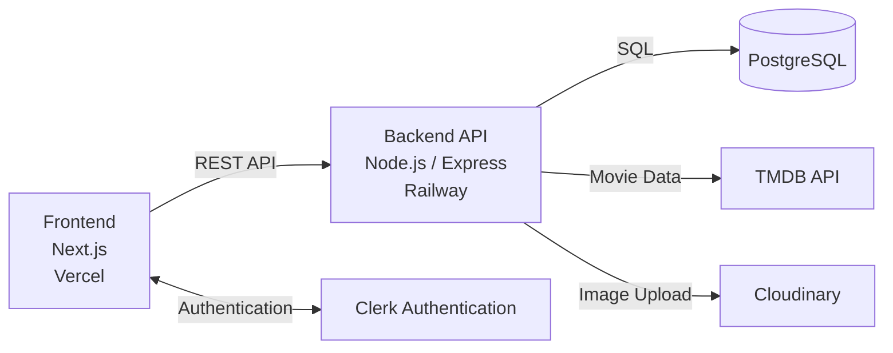
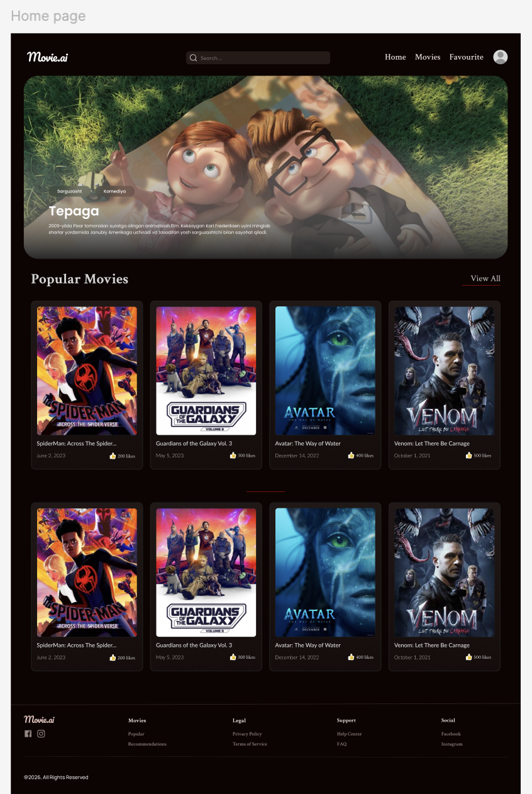
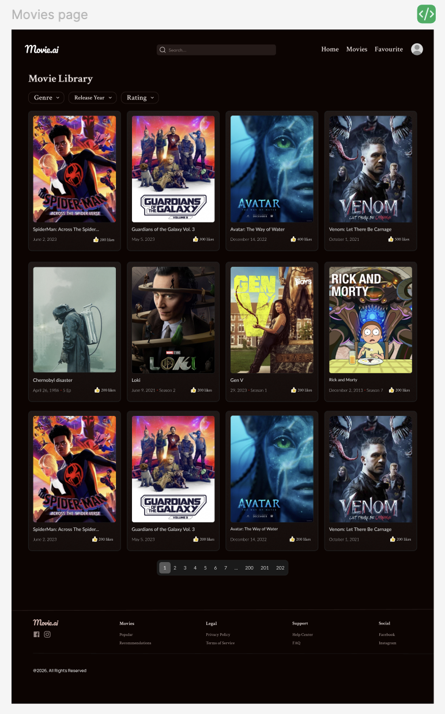
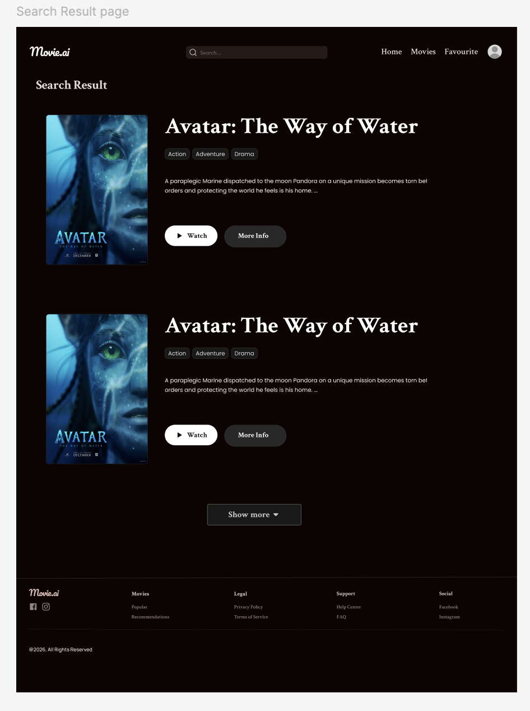

# Movie Review Platform

A full stack movie platform for discovering movies, browsing movie details, saving favorites, tracking watch list, and writing reviews.

## Features

- Movie discovery and search with TMDB
- Movie details, cast information, and watch-provider links
- Authentication and profile sync with Clerk
- Favorites, watched tracking, and reviews
- Avatar upload and edit with Cloudinary

## Tech Stack

- Next.js
- TypeScript
- Node.js
- Express.js
- Prisma
- PostgreSQL
- Clerk
- TMDB API
- Cloudinary
- Tailwind CSS
- Postman
- Figma
- Vercel
- Railway
- Cypress

## Project Structure

```text
frontend/
  app/                Next.js app router pages and layouts
  components/         Reusable UI and feature components
  lib/api/            Frontend API clients for backend requests
  types/              Shared frontend TypeScript types

backend/
  src/controllers/    Request handlers for movies, users, and reviews
  src/routes/         Express route definitions
  src/services/       External service integrations and business logic
  src/schemas/        Zod request validation schemas
  src/lib/            Shared backend utilities such as Prisma client
  prisma/             Database schema and migrations
```

## System Architecture



## Design Preview

Designs were prototyped in Figma before implementation. Some design references and visual assets were adapted from Figma Community resources and customized for this project.







Figma Prototype: https://www.figma.com/design/qANj437UhEpbQoy2F7C5m0/Movie.ai?node-id=0-1&t=1tfC5tjrs04VXD0z-1

## Running Locally

From the project root (`movie-db`), install dependencies once:

```bash
npm install
npm --prefix frontend install
npm --prefix backend install
```

Start both the frontend and backend together:

```bash
npm run dev
```

Press `Ctrl+C` to stop both services. To start only one service from the project root, use `npm run dev:frontend` or `npm run dev:backend`.

## Environment Variables

The project expects environment variables for the frontend and backend services.

### Frontend

- `NEXT_PUBLIC_API_BASE_URL`
- Clerk public configuration

### Backend

- `PORT`
- `DATABASE_URL`
- `TMDB_API_KEY`
- `CORS_ORIGIN`
- Cloudinary configuration

## Sync Movie Documents for RAG

The sync script imports 100 popular movies from TMDB into `MovieDocument` by default.
It fetches movie details and credits, saves metadata for filtering, and builds text
with a SHA-256 content hash for future embeddings. It does not generate embeddings yet.

Configure `DATABASE_URL` and `TMDB_API_KEY` in `backend/.env`, then run:

```bash
cd backend
npx prisma generate
npm run sync:movies
```

The target database must already have the committed Prisma migrations applied.
The script writes to the database specified by `DATABASE_URL`. When running from
your computer against Railway, use the database's public connection URL.

To sync a different number of movies or view the available options:

```bash
npm run sync:movies -- --count 20
npm run sync:movies -- --help
```

Each movie is upserted using its unique `tmdbId`, so rerunning the script updates
existing records and refreshes `syncedAt`. The requested count is the number processed
in that run, not a limit on the total records in the table; TMDB's popular list changes
over time. Ratings are stored separately from the retrieval text, so rating changes
do not change `contentHash`. Movie data is fetched in English, matching the website.

Requests run sequentially with a 15-second timeout each. If a request or database
write fails, the script stops with a nonzero exit code and keeps completed writes.
It also reports failure if TMDB cannot provide the requested number of unique movies.
Rerun the command after resolving the error.

Offline checks for the sync script:

```bash
npm run check:scripts
npm run test:sync-movies
```

The data comes from TMDB's [popular movies](https://developer.themoviedb.org/reference/movie-popular-list)
and [movie details](https://developer.themoviedb.org/reference/movie-details) endpoints.

## Cypress Testing

Frontend E2E tests are written with Cypress and should be run from the `frontend` app.

### Test Environment Setup

Create `frontend/.env.e2e` for the Cypress test environment. This file should use the Clerk test application keys instead of the normal development keys.

Example:

```bash
NEXT_PUBLIC_CLERK_PUBLISHABLE_KEY=pk_test_xxx
CLERK_SECRET_KEY=sk_test_xxx
NEXT_PUBLIC_API_BASE_URL=http://localhost:4000
```

If a test uses a fixed test account, add credentials in `frontend/cypress.env.json`.

Example:

```json
{
  "USER_EMAIL": "movieai+clerk_test@example.com",
  "USER_PASSWORD": "TestPassword123!"
}
```

### Run Cypress Locally

Start the backend:

```bash
cd backend
npm install
npm run dev
```

Start the frontend with the E2E environment:

```bash
cd frontend
npm install
npm run dev:e2e
```

Open Cypress with the E2E environment:

```bash
cd frontend
npm run cypress:open:e2e
```

Run Cypress headlessly:

```bash
cd frontend
npm run cypress:run:e2e
```

## Deployment

- Frontend deployed on Vercel
- Backend and database services deployed on Railway
