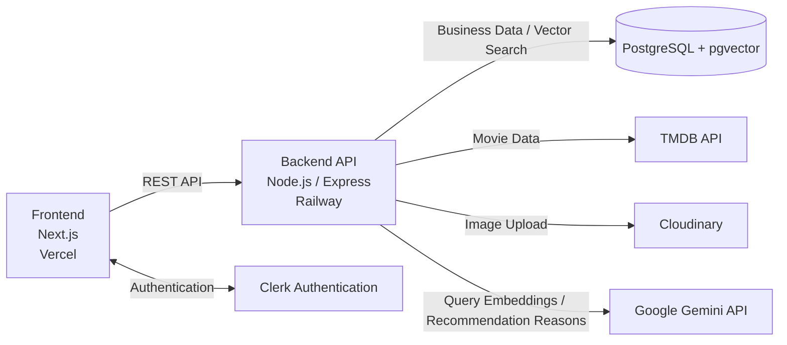
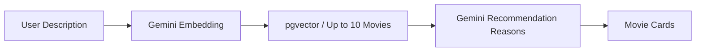

# Movie Review Platform

A full stack movie platform for discovering movies through title search and natural-language AI search, browsing movie details, saving favorites, tracking watched movies, and writing reviews.

## Features

- Movie discovery and search with TMDB
- RAG-powered AI movie search with semantic retrieval and generated recommendation reasons
- Movie details, cast information, and watch-provider links
- Authentication and profile sync with Clerk
- Favorites, watched tracking, and reviews
- Avatar upload and edit with Cloudinary

## Tech Stack

- Next.js
- TypeScript
- Node.js
- Express.js
- Prisma
- PostgreSQL
- pgvector
- Google Gemini API for embeddings and recommendation generation
- Clerk
- TMDB API
- Cloudinary
- Tailwind CSS
- Postman
- Figma
- Vercel
- Railway
- Cypress

## Project Structure

```text
frontend/
  app/                Next.js app router pages and layouts
  components/         Reusable UI and feature components
  lib/api/            Frontend API clients for backend requests
  types/              Shared frontend TypeScript types

backend/
  src/controllers/    Request handlers for movies, users, and reviews
  src/routes/         Express route definitions
  src/services/       External service integrations and business logic
  src/schemas/        Zod request validation schemas
  src/lib/            Shared backend utilities such as Prisma client
  prisma/             Database schema and migrations
  scripts/            TMDB document sync and incremental embedding generation
```

## System Architecture



## RAG Movie Search

Describe a movie, mood, or story to find related movies with AI-generated
recommendation reasons. The RAG pipeline combines Gemini embeddings, pgvector
retrieval, and Gemini text generation:



TMDB movie documents and 1,536-dimensional embeddings are prepared before searching.
Only synced documents with current embeddings are searched. Gemini generates reasons
from the retrieved metadata, and Zod validates the output. Ordinary title search
queries TMDB directly.

## Design Preview

Designs were prototyped in Figma before implementation. Some design references and visual assets were adapted from Figma Community resources and customized for this project.


Figma Prototype: https://www.figma.com/design/qANj437UhEpbQoy2F7C5m0/Movie.ai?node-id=0-1&t=1tfC5tjrs04VXD0z-1

## Running Locally

From the project root (`movie-db`), install dependencies once:

```bash
npm install
npm --prefix frontend install
npm --prefix backend install
```

Configure the environment variables below before starting. To enable AI search,
also complete [Set Up RAG Movie Search](#set-up-rag-movie-search).

Start both the frontend and backend together:

```bash
npm run dev
```

Press `Ctrl+C` to stop both services. To start only one service from the project root, use `npm run dev:frontend` or `npm run dev:backend`.

## Environment Variables

The project expects environment variables for the frontend and backend services.

### Frontend

- `NEXT_PUBLIC_API_BASE_URL` (for local development: `http://localhost:4000/api`)
- Clerk public configuration

### Backend

- `PORT`
- `DATABASE_URL`
- `TMDB_API_KEY`
- `CORS_ORIGIN`
- Cloudinary configuration

Additional backend settings for AI search:

- `GEMINI_API_KEY`
- `GEMINI_EMBEDDING_MODEL` (supports 1,536 output dimensions)
- `GEMINI_GENERATION_MODEL` (supports structured JSON output)

Create `backend/.env` from [backend/.env.example](backend/.env.example) if needed.
Keep API keys in the backend and choose model IDs available to your Gemini API key.

## Set Up RAG Movie Search

Use PostgreSQL with pgvector installed and a database user that can enable the
`vector` extension. Configure `backend/.env` with the settings above, then run
from the project root:

```bash
cd backend
npx prisma migrate deploy
npx prisma generate
npm run sync:movies
npm run generate:embeddings
```

Sync imports 100 popular movies by default; embedding generation processes up to
100 missing or outdated documents per run. Use `--count` and `--limit` respectively
to change batch sizes. Rerun embedding generation when movie content or the
embedding model changes; current vectors are skipped.

Start the app with `npm run dev` from the project root. Open **AI movie search**
in the header, describe what you want to watch, and select **Find movies**.

## Cypress Testing

Frontend E2E tests are written with Cypress and should be run from the `frontend` app.

### Test Environment Setup

Create `frontend/.env.e2e` for the Cypress test environment. This file should use the Clerk test application keys instead of the normal development keys.

Example:

```bash
NEXT_PUBLIC_CLERK_PUBLISHABLE_KEY=pk_test_xxx
CLERK_SECRET_KEY=sk_test_xxx
NEXT_PUBLIC_API_BASE_URL=http://localhost:4000/api
```

If a test uses a fixed test account, add credentials in `frontend/cypress.env.json`.

Example:

```json
{
  "USER_EMAIL": "movieai+clerk_test@example.com",
  "USER_PASSWORD": "TestPassword123!"
}
```

### Run Cypress Locally

Start the backend:

```bash
cd backend
npm install
npm run dev
```

Start the frontend with the E2E environment:

```bash
cd frontend
npm install
npm run dev:e2e
```

Open Cypress with the E2E environment:

```bash
cd frontend
npm run cypress:open:e2e
```

Run Cypress headlessly:

```bash
cd frontend
npm run cypress:run:e2e
```

## Deployment

- Frontend deployed on Vercel
- Backend and database services deployed on Railway
