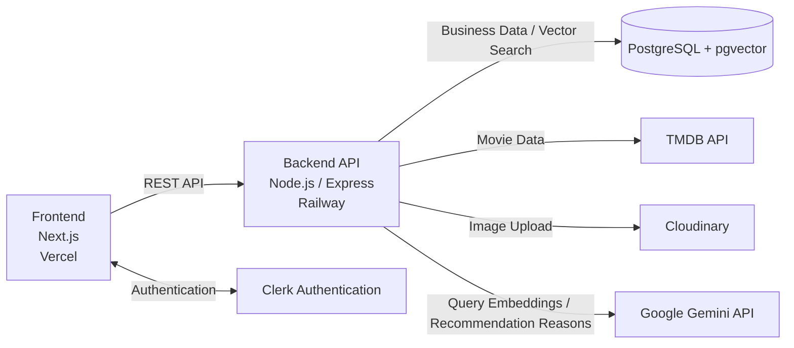
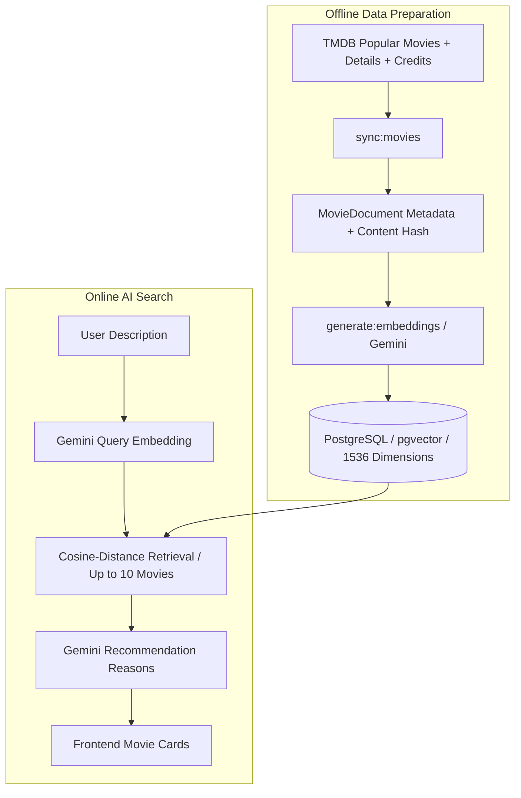

# Movie Review Platform

A full stack movie platform for discovering movies through title search and natural-language AI search, browsing movie details, saving favorites, tracking watched movies, and writing reviews.

## Features

- Movie discovery and search with TMDB
- RAG-powered AI movie search with semantic retrieval and generated recommendation reasons
- Movie details, cast information, and watch-provider links
- Authentication and profile sync with Clerk
- Favorites, watched tracking, and reviews
- Avatar upload and edit with Cloudinary

## Tech Stack

- Next.js
- TypeScript
- Node.js
- Express.js
- Prisma
- PostgreSQL
- pgvector
- Google Gemini API for embeddings and recommendation generation
- Clerk
- TMDB API
- Cloudinary
- Tailwind CSS
- Postman
- Figma
- Vercel
- Railway
- Cypress

## Project Structure

```text
frontend/
  app/                Next.js app router pages and layouts
  components/         Reusable UI and feature components
  lib/api/            Frontend API clients for backend requests
  types/              Shared frontend TypeScript types

backend/
  src/controllers/    Request handlers for movies, users, and reviews
  src/routes/         Express route definitions
  src/services/       External service integrations and business logic
  src/schemas/        Zod request validation schemas
  src/lib/            Shared backend utilities such as Prisma client
  prisma/             Database schema and migrations
  scripts/            TMDB document sync and incremental embedding generation
```

## System Architecture



## RAG Movie Search

AI search lets users describe a movie, mood, or story, such as "a sci-fi movie
about time travel and family." It uses retrieval-augmented generation (RAG) to
retrieve related movies from a local collection and generate a short recommendation
reason for each result. Ordinary title search continues to query TMDB separately.



- **Prepare movie documents:** Sync English movie metadata from TMDB. The retrieval
  text includes the title, year, genres, runtime, director, leading cast, and overview
  when available. A SHA-256 content hash tracks changes.
- **Generate embeddings:** Store normalized 1,536-dimensional Gemini embeddings in
  `MovieDocument`. Generate only missing vectors or vectors whose model or source
  content has changed. A hash check at write time prevents saving a vector for a
  document that changed during generation.
- **Retrieve candidates:** Embed the user's description and use pgvector cosine
  distance to retrieve up to 10 movies. Only documents with the configured embedding
  model and an up-to-date content hash are eligible.
- **Generate reasons:** Send the query and retrieved metadata to Gemini. The prompt
  instructs the model to use only this metadata and acknowledge uncertain matches.
  JSON Schema and Zod validate the returned IDs, count, uniqueness, and reason length.
  The backend attaches reasons to the original candidates in retrieval order.

The collection is limited to movies that have been synced and successfully embedded.
Recommendations use the current query and movie metadata; they do not use a user's
favorites or viewing history. The current implementation has no similarity cutoff,
strict year/runtime filters, or reranking step. Output validation constrains the
candidate IDs and response format; the factual accuracy of reasons still needs
evaluation.

## Design Preview

Designs were prototyped in Figma before implementation. Some design references and visual assets were adapted from Figma Community resources and customized for this project.


Figma Prototype: https://www.figma.com/design/qANj437UhEpbQoy2F7C5m0/Movie.ai?node-id=0-1&t=1tfC5tjrs04VXD0z-1

## Running Locally

From the project root (`movie-db`), install dependencies once:

```bash
npm install
npm --prefix frontend install
npm --prefix backend install
```

Configure the environment variables below before starting. To enable AI search,
also complete [Set Up RAG Movie Search](#set-up-rag-movie-search).

Start both the frontend and backend together:

```bash
npm run dev
```

Press `Ctrl+C` to stop both services. To start only one service from the project root, use `npm run dev:frontend` or `npm run dev:backend`.

## Environment Variables

The project expects environment variables for the frontend and backend services.

### Frontend

- `NEXT_PUBLIC_API_BASE_URL` (for local development: `http://localhost:4000/api`)
- Clerk public configuration

### Backend

- `PORT`
- `DATABASE_URL`
- `TMDB_API_KEY`
- `CORS_ORIGIN`
- Cloudinary configuration

Additional backend settings for AI search:

| Variable | Purpose | Default / fallback |
| --- | --- | --- |
| `GEMINI_API_KEY` | Gemini API access for embedding and generation | Falls back to `GOOGLE_API_KEY` |
| `GEMINI_EMBEDDING_MODEL` | Embedding model supporting 1,536 output dimensions | Falls back to `EMBEDDING_MODEL`; no default model |
| `GEMINI_GENERATION_MODEL` | Generation model supporting structured JSON output | Required; no default model |
| `AI_SEARCH_RATE_LIMIT_MAX` | Maximum AI search requests per IP per window | `5` |
| `AI_SEARCH_RATE_LIMIT_WINDOW_MS` | AI search rate-limit window in milliseconds | `60000` |

Keep API keys in the backend environment. For local development, create `backend/.env`
from [backend/.env.example](backend/.env.example) if it does not already exist.
Set the model IDs to models available to your Gemini API key with the capabilities
listed above.

## Set Up RAG Movie Search

### 1. Prepare the database

Use a PostgreSQL server with pgvector installed. Configure `DATABASE_URL` in
`backend/.env`, then apply the committed migrations and generate the Prisma client:

```bash
cd backend
npx prisma migrate deploy
npx prisma generate
```

The migrations enable the `vector` extension and create the `MovieDocument` table
with a `vector(1536)` column. The database user must be able to enable the extension.
These commands and the data preparation scripts use the database selected by
`DATABASE_URL`. When connecting from your computer to Railway, use the database's
public connection URL.

### 2. Sync movie documents

Configure `TMDB_API_KEY`, then run from `backend/`:

```bash
npm run sync:movies
```

The script processes 100 popular movies by default. It fetches movie details and
credits, saves metadata and retrieval text, and calculates the content hash.
Embedding generation is a separate step.

To sync a different number of movies or view the available options:

```bash
npm run sync:movies -- --count 20
npm run sync:movies -- --help
```

Each movie is upserted using its unique `tmdbId`, so rerunning the script updates
existing records and refreshes `syncedAt`. The requested count is the number processed
in that run, not a limit on the total records in the table; TMDB's popular list changes
over time. Ratings are stored separately from the retrieval text, so rating changes
do not change `contentHash`. Movie data is fetched in English, matching the website.

Requests run sequentially with a 15-second timeout each. If a request or database
write fails, the script stops with a nonzero exit code and keeps completed writes.
It also reports failure if TMDB cannot provide the requested number of unique movies.
Rerun the command after resolving the error.

The data comes from TMDB's [popular movies](https://developer.themoviedb.org/reference/movie-popular-list)
and [movie details](https://developer.themoviedb.org/reference/movie-details) endpoints.

### 3. Generate embeddings

Configure the Gemini API key and embedding model, then run from `backend/`:

```bash
npm run generate:embeddings
```

By default, the script selects up to 100 documents with missing or outdated vectors
and waits 1,000 ms between documents. It records `embeddingModel`,
`embeddedContentHash`, and `embeddedAt` alongside each vector.

To change the batch size or delay, or view the available options:

```bash
npm run generate:embeddings -- --limit 200 --delay-ms 1000
npm run generate:embeddings -- --help
```

Repeat the command if more pending documents remain. Rerunning skips current
vectors; changing the embedding model or retrieval text makes affected documents
eligible for regeneration. Rating-only changes do not require new embeddings.
Documents with invalid or oversized embedding input are skipped and reported;
other errors stop the run and preserve completed writes.

### 4. Run and try AI search

Configure `GEMINI_GENERATION_MODEL` and start both applications with `npm run dev`
from the project root. Open the AI movie search button in the header, enter a
description, and select **Find movies**. The frontend navigates to
`/search?mode=ai&query=...` and displays movie cards with English recommendation
reasons. Movie detail pages require signing in.

The backend endpoint is `GET /api/movies/search/semantic`. For example:

```bash
curl --get 'http://localhost:4000/api/movies/search/semantic' \
  --data-urlencode 'query=A sci-fi movie about time travel and family'
```

The trimmed query must contain 3–500 characters and fit the embedding service's
1,800-byte input limit, including any model-specific prefix. A successful response
has a `results` array containing up to 10 movies with `tmdbId`, `title`, `posterUrl`,
`overview`, `year`, `rating`, `genres`, `runtime`, and `reason`.

| Status | Meaning |
| --- | --- |
| `400` | Invalid or oversized query |
| `429` | AI search rate limit reached |
| `503` / `NOT_CONFIGURED` | Missing embedding or generation configuration |
| `503` / `INDEX_NOT_READY` | No current embeddings for the configured model; complete the preparation steps above |
| `503` / `SEARCH_UNAVAILABLE` | Embedding or recommendation generation failed, timed out, or returned invalid output |
| `500` / `SEARCH_FAILED` | Unexpected search or database failure |

Embedding requests have a 12-second timeout and generation requests have a
15-second timeout. If reason generation fails, the endpoint returns an error;
it currently does not return the retrieved movies without reasons. The frontend
currently shows `Not found` for both empty results and failed AI requests.

To type-check the backend and data preparation scripts without making API requests
or writing to the database, run from `backend/`:

```bash
npm run check:scripts
```

## Cypress Testing

Frontend E2E tests are written with Cypress and should be run from the `frontend` app.

### Test Environment Setup

Create `frontend/.env.e2e` for the Cypress test environment. This file should use the Clerk test application keys instead of the normal development keys.

Example:

```bash
NEXT_PUBLIC_CLERK_PUBLISHABLE_KEY=pk_test_xxx
CLERK_SECRET_KEY=sk_test_xxx
NEXT_PUBLIC_API_BASE_URL=http://localhost:4000/api
```

If a test uses a fixed test account, add credentials in `frontend/cypress.env.json`.

Example:

```json
{
  "USER_EMAIL": "movieai+clerk_test@example.com",
  "USER_PASSWORD": "TestPassword123!"
}
```

### Run Cypress Locally

Start the backend:

```bash
cd backend
npm install
npm run dev
```

Start the frontend with the E2E environment:

```bash
cd frontend
npm install
npm run dev:e2e
```

Open Cypress with the E2E environment:

```bash
cd frontend
npm run cypress:open:e2e
```

Run Cypress headlessly:

```bash
cd frontend
npm run cypress:run:e2e
```

## Deployment

- Frontend deployed on Vercel
- Backend and database services deployed on Railway
